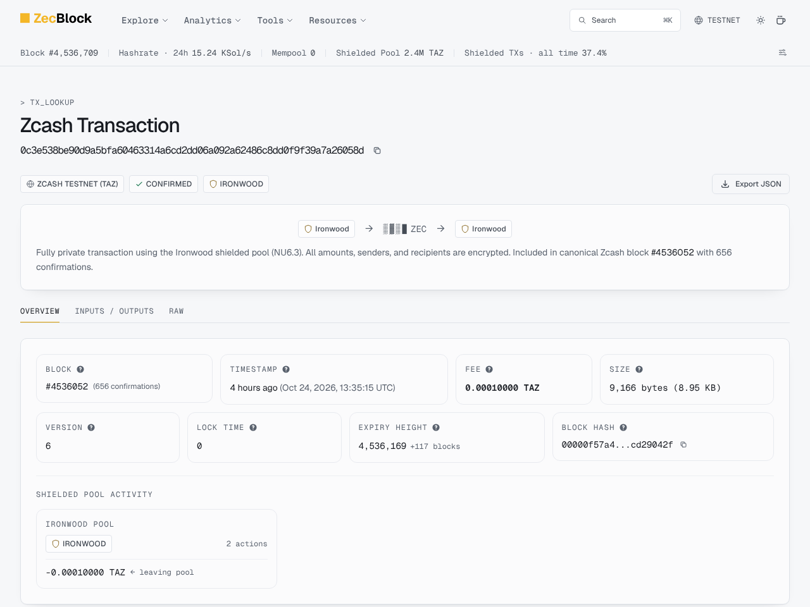

# Fare

[](https://github.com/abdoulore/fare/actions/workflows/ci.yml)

Pay once in shielded ZEC. Then every API call carries a single-use token that neither the API nor the issuer that sold it can match to your payment. Tokens do not hide your IP address, the timing of your requests or what you ask; see [Residuals](#residuals).

Built for ZECATHON 2026, Shielded Payments track. Runs on Zcash testnet.

**Try it: https://fare.moonrider.online** (Zcash testnet). [`/app`](https://fare.moonrider.online/app) to buy 100 calls and spend them, [`/developers`](https://fare.moonrider.online/developers) to add Fare to your own API, [`/proof`](https://fare.moonrider.online/proof) to check every claim against chain data and the published key.


## How it works

1. The API answers `402` with a Privacy Pass challenge and a price for a fixed pack: 100 calls for 0.001 TAZ.
2. The client checks the challenge's key against the issuer key it pinned, blinds 100 nonces and orders a pack. Fare mints a fresh shielded-only address for that purchase.
3. The payer pays it from shielded notes (in the demo, `fare-wallet`). The scanner matches the payment to the purchase by diversifier index, from compact blocks alone: no memo, no transaction lookup.
4. After one confirmation the issuer blind-signs. The client unblinds 100 tokens (RFC 9578, type 2).
5. Each call spends one token. The API verifies it but cannot tie it to the purchase, the payer, or the caller's other calls.

## Testnet proof

Every payment below is a real testnet transaction, paid by `fare-wallet` and detected by `fare-scanner` from compact blocks. All went to purchase addresses of one demo merchant, whose **incoming viewing key is published here** so anyone can check them:

```
uivktest160nugcs8fnvmx98nuqy982yadezp0uk8h8chq47uq74q3rqgynurv0tfc77vvsmn38f6nn25mtnyq0rkvjamsujht3yacjp8uvtacatxwgatjy54f3g4el376ur2t7f55d4f5dhjxmalvay2xvh4ycfgz032z692hgcenqa9wn5ua5van6n9xqguutnsurjccpsmstrnd3xcjvwxtnnqv7wa5y060rcg7e3h2wt7ycrskv4nt2a
```

It reveals incoming payments to this demo account only: amount, height, address index. It cannot spend, and it reveals nothing about tokens or API calls.

| Index | Amount (TAZ) | Height | Txid | What it shows | Run | On chain |
| --- | --- | --- | --- | --- | --- | --- |
| +0 | 0.001 | 4,535,557 | `fd1e9ee3f90c0e3bd8bf874e86352ab8fb085158190c5242a27e0afa623af9d9` | Canary: paid, matched by index | [canary](https://github.com/abdoulore/fare/actions/runs/40084407257) | [explorer](https://testnet.zecblock.com/tx/fd1e9ee3f90c0e3bd8bf874e86352ab8fb085158190c5242a27e0afa623af9d9), [screenshot](docs/explorer/0-canary-paid.png) |
| +1 | 0.0005 | 4,535,562 | `0346de58cdaa73d7285e7e91448effa2c437978b44cfdf1bc72a4cf9b866652b` | Canary: underpaid, stays underpaid | [canary](https://github.com/abdoulore/fare/actions/runs/40084407257) | [explorer](https://testnet.zecblock.com/tx/0346de58cdaa73d7285e7e91448effa2c437978b44cfdf1bc72a4cf9b866652b), [screenshot](docs/explorer/1-canary-underpaid.png) |
| +2 | 0.001 | 4,535,836 | `9a6e1bf355929f15ccf13035d00c8e6dea01e56145d6ea4dbb068d71bdb24740` | Minted over HTTP by `serve`: pending, in mempool, paid | [serve](https://github.com/abdoulore/fare/actions/runs/40091932215) | [explorer](https://testnet.zecblock.com/tx/9a6e1bf355929f15ccf13035d00c8e6dea01e56145d6ea4dbb068d71bdb24740), [screenshot](docs/explorer/2-serve.png) |
| +3 | 0.001 | 4,535,984 | `2e97c74b44bce98c4b6707928c78df62e6b630b042146b824dea833b964ae5b8` | Whole stack: 402, pay, 100 tokens, 5 calls, replay refused | [demo](https://github.com/abdoulore/fare/actions/runs/40096150452) | [explorer](https://testnet.zecblock.com/tx/2e97c74b44bce98c4b6707928c78df62e6b630b042146b824dea833b964ae5b8), [screenshot](docs/explorer/3-demo.png) |
| +4 | 0.001 | 4,536,048 | `b01a1fc002e2ff71a6b8438b5f403eda48bdd948a9936b0f01d6e819dc7fa4df` | Paid: 100 tokens, a call succeeds | [failure paths](https://github.com/abdoulore/fare/actions/runs/40098320054) | [explorer](https://testnet.zecblock.com/tx/b01a1fc002e2ff71a6b8438b5f403eda48bdd948a9936b0f01d6e819dc7fa4df), [screenshot](docs/explorer/4-paid.png) |
| +5 | 0.0005 | 4,536,052 | `0c3e538be90d9a5bfa60463314a6cd2dd06a092a62486c8dd0f9f39a7a26058d` | Underpaid: no signatures issued | [failure paths](https://github.com/abdoulore/fare/actions/runs/40098320054) | [explorer](https://testnet.zecblock.com/tx/0c3e538be90d9a5bfa60463314a6cd2dd06a092a62486c8dd0f9f39a7a26058d), [screenshot](docs/explorer/5-underpaid.png) |
| +6 | 0.001 | 4,536,054 | `60d3f691c7b71deb4f7eb890f3e2967971c78ced8cf287d62b1d271c7b30ebf3` | Second payment, first of two | [failure paths](https://github.com/abdoulore/fare/actions/runs/40098320054) | [explorer](https://testnet.zecblock.com/tx/60d3f691c7b71deb4f7eb890f3e2967971c78ced8cf287d62b1d271c7b30ebf3), [screenshot](docs/explorer/6a-second.png) |
| +6 | 0.001 | 4,536,061 | `d3529ffb9e1cedcc2cdc0bdb3216de385a0e255db60912ef31d6b700532ba652` | Second payment: still exactly 100 tokens | [failure paths](https://github.com/abdoulore/fare/actions/runs/40098320054) | [explorer](https://testnet.zecblock.com/tx/d3529ffb9e1cedcc2cdc0bdb3216de385a0e255db60912ef31d6b700532ba652), [screenshot](docs/explorer/6b-second.png) |
| +7 | 0.001 | 4,536,656 | `5d3b23ef7896b27a7d18d91da016a6f68be87152fc66c3f65bf35d0fbba817e0` | Hosted site, in a browser: demo payer paid, 100 tokens unblinded in the page, 3 calls, replay refused | [hosted run](docs/hosted/oct24/) | [explorer](https://testnet.zecblock.com/tx/5d3b23ef7896b27a7d18d91da016a6f68be87152fc66c3f65bf35d0fbba817e0), [screenshot](docs/explorer/7-hosted.png) |
| +9 | 0.001 | 4,541,068 | `584ef994733402213b267c772d0fcfd3b2b93ae7cbec9ba5e5c3d817d477745f` | Redesigned hosted site, in a browser: demo payer paid, 100 tokens unblinded in the page, 3 calls, replay refused | [hosted run](docs/hosted/redesign/) | [explorer](https://testnet.zecblock.com/tx/584ef994733402213b267c772d0fcfd3b2b93ae7cbec9ba5e5c3d817d477745f) |
| +10 | 0.001 | 4,544,481 | `dddc693bfa2212358a8db44631a23ee5f5e36742b7b0bb1c0beac95ee7614dfe` | Hosted site after the Oct 26 fixes (saved orders, shared tabs, shared spent set): demo payer paid, 100 tokens unblinded in the page, 3 calls, replay refused | [hosted run](docs/hosted/oct26/) | [explorer](https://testnet.zecblock.com/tx/dddc693bfa2212358a8db44631a23ee5f5e36742b7b0bb1c0beac95ee7614dfe) |

### Hosted runs

`web/e2e/hosted.spec.ts` drives a real browser through https://fare.moonrider.online and pays with Fare's demo payer: the 402 names the published key, the browser blinds 100 nonces and orders, the payment confirms, the browser unblinds 100 tokens, makes 3 calls (answers simulated: no model key on the host) and replays one, which gets `401 token_reused`. Every run also checks that no request leaves the site and its three subdomains.

| Date | Purchase | Txid | Site version | Record |
| --- | --- | --- | --- | --- |
| Oct 24 | +7, height 4,536,656 | `5d3b23ef7896b27a7d18d91da016a6f68be87152fc66c3f65bf35d0fbba817e0` | First version | [`docs/hosted/oct24/`](docs/hosted/oct24/) |
| Oct 25 | +9, height 4,541,068 | `584ef994733402213b267c772d0fcfd3b2b93ae7cbec9ba5e5c3d817d477745f` | Sheet-of-stamps redesign | [`docs/hosted/redesign/`](docs/hosted/redesign/) |
| Oct 26 | +10, height 4,544,481 | `dddc693bfa2212358a8db44631a23ee5f5e36742b7b0bb1c0beac95ee7614dfe` | Orders saved before payment, one token store across tabs, a spent set shared safely by processes | [`docs/hosted/oct26/`](docs/hosted/oct26/) |
| Oct 27 | +16, height 4,546,503 | `e6b27e3a6ba4a0b6715239b6cbdf68dfdc332af12ea1768f8d3af3ca0d031075` | "Buy another sheet" works for a holder of unspent tokens | [`docs/hosted/oct27/`](docs/hosted/oct27/) |

The other purchases on the live ledger: +8 was ordered and never paid, so it stays pending. +11 to +15 were bought on the hosted site on Oct 26 while recording the demo video, all paid by the demo payer: +11, +13 and +15 in full, +12 and +14 half on purpose to show the refusal, so they stay postage due with no tokens signed.

### Check it yourself

With the published key only, no seed and nothing from us:

```
cd scanner && cargo build --release
./target/release/fare-scanner --dir verify init --network test --uivk <key above> --birthday 4535550
./target/release/fare-scanner --dir verify scan --from 4535550 --check-transparent
./target/release/fare-scanner --dir verify status
```

`init --uivk` makes a watch-only verifier: it holds no seed and refuses to mint. `status` lists every payment to the key by purchase index, with amount, height and txid. The [failure-paths run](https://github.com/abdoulore/fare/actions/runs/40098320054) does exactly this on a fresh runner and lists +4, +5 and +6 as above.

The scan needs a machine that can reach `testnet.zec.rocks`.

### What a chain observer sees

The transactions from +0 to +7 on a public testnet explorer ([ZecBlock](https://testnet.zecblock.com), screenshots in [`docs/explorer/`](docs/explorer/)): each is an Ironwood transaction with 2 actions, a fee of 0.0001 TAZ as the only value leaving the pool, and no sender, recipient, amount or memo. All nine are 9,166 bytes. A paid purchase, an underpaid one and a second payment look the same; only the published viewing key tells them apart.



## What is real

| Part | State |
| --- | --- |
| Payments | Real testnet TAZ, paid from shielded notes by `fare-wallet`. Mainnet was not run: the project runs on testnet by design |
| Payment detection | Real: trial decryption of real compact blocks from `testnet.zec.rocks`, by diversifier index, no memo, no transaction lookup |
| Tokens | Real RFC 9578 type 2 (Blind RSA 2048, PSS) via `@cloudflare/privacypass-ts`; issuer signatures by native OpenSSL, each verified before release |
| Redemption | Real: key id, challenge digest, signature and spent set checked on every call |
| Demo API answers | **Simulated** in every testnet run so far: the repo has no model API key, so a canned responder answers and says so. With `ANTHROPIC_API_KEY` set, answers come from Claude |
| Panel | Real counts from the issuer's purchase store and the origin's spent set |
| Frontend (`web/`) | Real: tokens are blinded, unblinded and stored in the visitor's browser. Its end-to-end tests run against a stub scanner and a stub wallet, labeled as such in `web/e2e/stack.ts` |
| Demo payer | When used, a real testnet payment from Fare's own `fare-wallet`, not the visitor's. The page says so on every payment |
| Hosting | https://fare.moonrider.online: one VPS behind Caddy, set up with `deploy/`. Answers there are simulated until the host has a model key |
| Explorer screenshots | Real: every proof txid on a public testnet explorer, in `docs/explorer/` |

## Threat model

No party holds both ends. The issuer sees purchases and blinded messages; the origin sees tokens; nothing joins the two.

| Who | Sees | Cannot see |
| --- | --- | --- |
| Chain observer | A shielded transaction and its fee | Payer, amount, purchase address, which service |
| lightwalletd operator (merchant side) | The scanner's IP, block ranges, mempool snapshots | Which transactions are the merchant's |
| lightwalletd operator (payer side) | The payer's IP, its sync and the transaction it broadcasts | The amount, the recipient, which purchase it pays |
| Issuer | Purchase id, price, payment status, 100 blinded messages, the client's IP at order time | The tokens those messages become |
| Origin | Each token, its arrival time, the request, the client's IP | The purchase behind a token; whether two calls share a buyer |
| Model provider (demo, when enabled) | The prompt | Who asked: no user id, address or token is sent |
| Anyone with the published demo key | Every payment to the demo merchant: amount, index, height | Tokens, calls, payers |

What enforces it, each with a test (`docs/SPEC.md` lists them):

- Purchase addresses carry an Orchard-type receiver only, at a fresh index per purchase, never reused.
- No memo; the scanner never asks a server for one transaction or address. Source checks fail the build otherwise.
- One pack size; the issuer refuses any other N.
- One issuer key per 7-day epoch, published in the directory. The client refuses any key the directory does not list.
- The issuer never handles tokens and the origin never handles purchases. Neither logs client addresses, user agents or request times. Source checks fail the build otherwise.
- Tokens issue only after one confirmation, never from the mempool.
- Payments funded from transparent inputs are flagged.

## Residuals

What Fare does not protect, stated plainly:

- **Network metadata.** An order and the first call from one IP, close in time, can be correlated. One confirmation (about 75 s) separates them, which is not much. Fare does not route traffic: run the client through Tor or a proxy if this matters. The same applies to the payer's connection to lightwalletd.
- **One operator, both sides.** The cryptography unlinks tokens from purchases. If one party runs the issuer and the origin, network metadata on both sides is theirs to compare.
- **Small anonymity set.** A token hides among the tokens issued under the same key. In the failure-paths run that was 200 tokens from 2 purchases, all one buyer. The panel shows the size.
- **Key consistency.** The client pins the key from its first directory fetch and follows rotations only through the directory. Nothing outside checks that every client sees the same directory.
- **Request content.** The origin reads what you ask, and in the demo so does the model provider. Fare unlinks identity, not content.
- **Transparent funding.** A payer who funds from a transparent balance exposes their own address. Fare flags it and cannot prevent it.
- **Expiring tokens.** Unspent tokens stop working when their key retires, 24 h after the key's 7-day epoch ends. A pack bought early in an epoch lasts about 8 days; one bought at its end, about 24 hours.
- **Lost tokens.** A token is spent before the request runs. If the model fails after that, the token is gone: refunding it would link it to the caller.
- **Reorgs.** Tokens issue at one confirmation. A payment whose block is later reorged out keeps its tokens; the merchant carries that loss.

## Run it

Chain access needs a machine that can reach `testnet.zec.rocks`. On GitHub, the workflows do everything:

| Workflow | Does |
| --- | --- |
| `testnet-wallet.yml` | Payer balance, funding address, or one payment |
| `testnet-hosted.yml` | The hosted run above, against a deployed site |
| `testnet-canary.yml` | The payment canary: paid and underpaid purchases, `fare-scanner check` |
| `testnet-serve.yml` | A purchase minted over HTTP flips to paid |
| `testnet-demo.yml` | The whole stack: agent pays, calls, replay refused, panel |
| `testnet-failure-paths.yml` | Paid, underpaid and paid twice, then the watch-only verifier |

They need the repository secrets `FARE_TESTNET_UFVK` (merchant viewing key) and `FARE_PAYER_SEED` (a testnet-only phrase), and optionally `ANTHROPIC_API_KEY`.

Locally, each in its own terminal:

```
cd scanner && cargo build --release && ./target/release/fare-scanner init --network test && ./target/release/fare-scanner serve
cd issuer && npm ci && npm start
cd demo && npm ci && npm run api                      # API on 127.0.0.1:8080, panel on 127.0.0.1:8790/panel
cd wallet && cargo build --release                    # then: export FARE_PAYER_SEED=..., fare-wallet init --birthday <height>
cd demo && CALLS=5 npm run agent
```

The frontend, against those services (start the issuer, the demo API and `npm run payer` in `demo/` with `WEB_ORIGINS=http://127.0.0.1:5173`):

```
cd web && npm ci && npm run dev                       # http://127.0.0.1:5173
```

Tests: `cargo test` in `scanner/` and `wallet/`, `npm test` in `issuer/`, `sdk/`, `origin/`, `demo/` and `web/`, and `npx playwright test` in `web/` (each package's README has the install line).

To host it: [`deploy/README.md`](deploy/README.md).

## Packages

| Package | What it is |
| --- | --- |
| [`scanner/`](scanner/) (Rust) | `fare-scanner`: per-purchase addresses, payment detection from compact blocks, the `serve` sidecar with an id-free ledger, the watch-only verifier |
| [`wallet/`](wallet/) (Rust) | `fare-wallet`: a headless testnet payer that pays only shielded, memo-free requests under a ceiling |
| [`issuer/`](issuer/) (TypeScript) | Issuer directory, purchases API, 7-day epoch keys, native blind signing, public ledger |
| [`sdk/`](sdk/) (TypeScript) | Client: pins the key, handles the 402, orders, collects, spends; follows key rotation; saves orders before payment; the core runs in browsers |
| [`origin/`](origin/) (TypeScript) | Middleware for your API: the 402 challenge, the redemption checks, a spent set shared safely by processes on one host |
| [`demo/`](demo/) (TypeScript) | An LLM proxy behind the origin, a paying agent, the server-view panel, the demo payer |
| [`web/`](web/) (TypeScript, React) | The site: buyer flow with tokens made in the browser, developer docs, the live proof pages |
| [`token-canary/`](token-canary/) (Node) | The Privacy Pass proof: 100 tokens issued and redeemed, refusal and unlinkability checks, native signing measured |
| [`deploy/`](deploy/) | One-VPS deployment: Caddy, systemd units, setup script |

CI runs every package's tests on every push. Demo answers are **simulated** unless the demo host has a model API key: the API, the agent output and the panel all say so.

## Documentation

| File | For |
| --- | --- |
| [`docs/SPEC.md`](docs/SPEC.md) | The design: decisions, flow, privacy model, and every failure path with the test that proves it |
| [`docs/api.md`](docs/api.md) | The HTTP contract between client, issuer, origin and scanner |
| [`docs/protocol.md`](docs/protocol.md) | Zcash, Ironwood and Privacy Pass facts the code relies on |
| [`CONTRIBUTING.md`](CONTRIBUTING.md) | Layout, build and test commands, the privacy invariants every change keeps |
| [`deploy/README.md`](deploy/README.md) | Hosting on one VPS |

`fare-scanner init` writes the merchant's seed to `fare-data/SEED-MOVE-OFFLINE.txt`, which is git-ignored: move it offline, since the running scanner needs only the viewing key. The payer seed lives only in the `FARE_PAYER_SEED` environment variable.

## Licence

Fare is dual-licensed under the [MIT licence](LICENSE-MIT) or the [Apache License 2.0](LICENSE-APACHE), at your option.
