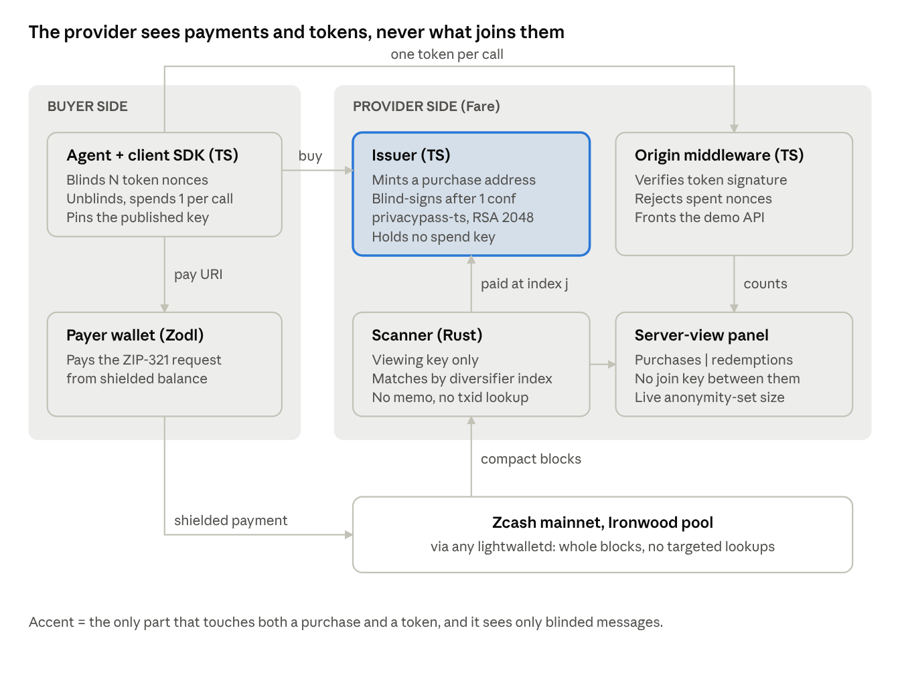

# Fare: design

Written Oct 23, 2026; updated through Oct 27, 2026.

## Summary and design decisions

Fare sells API access for shielded ZEC and redeems it with unlinkable tokens: the provider verifies every call but cannot tie a call to the purchase, the payer, or the caller's other calls.

| Decision | Choice |
| --- | --- |
| Tokens | Privacy Pass publicly verifiable tokens, Blind RSA 2048, PSS (RFC 9578 type 2) |
| Issue tokens at | 1 confirmation (about 75 s). Never from the mempool alone |
| Payment matching | Fresh shielded-only address per purchase, matched by diversifier index. No memo, no transaction lookups |
| Demo payer | `fare-wallet`, a headless testnet payer. Consumer wallets are not used: on Oct 24 Noir's testnet build signed with the pre-Ironwood branch id |
| Demo API | LLM proxy an agent calls in a loop. With no model API key on the host, a canned responder labeled "simulated" on every answer |
| Public proof | The demo merchant's incoming viewing key is published, so anyone can verify every payment |
| Networks | Testnet for the canary and the demo, server `testnet.zec.rocks`. Offline fixtures for development |
| Issuer signing | Native OpenSSL blind RSA, each signature verified against the public key before release |
| Pack and price | One pack: 100 calls for 0.001 TAZ. The issuer refuses any other N |
| Issuer key epoch | 7 days, previous key valid for a 24 h grace window |
| Hosting | One VPS behind Caddy: the static `web/` build plus `api.`, `issuer.` and `payer.` subdomains; scanner and panel on loopback only. DNS only, no CDN proxy in front |
| Hosted payer | Fare's demo payer (server-side `fare-wallet`, labeled as Fare's, 5 packs an hour, at most 0.001 TAZ each), and a QR for the visitor's own Ironwood wallet |
| Public server view | Purchase index, amount, height, status, redemption counts per key, anonymity-set size. Never purchase ids: an id fetches signatures |
| Hosted answers | Real Claude answers if the host has `ANTHROPIC_API_KEY`, otherwise simulated and labeled on every answer |

## Architecture

Four parts, two languages: a Rust scanner that only ever holds a viewing key, and TypeScript for everything token-shaped.

| Component | Language | Built on | Holds |
| --- | --- | --- | --- |
| Scanner | Rust | `orchard` 0.16, `zcash_client_backend` 0.25, `zcash_keys` 0.17 | Unified viewing key only |
| Issuer | TypeScript | `@cloudflare/privacypass-ts` for the protocol, native OpenSSL for the RSA signature | RSA signing key per epoch, purchase records |
| Origin middleware | TypeScript | `privacypass-ts` verify | Issuer public key, spent-nonce set |
| Client SDK | TypeScript | `privacypass-ts` client | Pinned issuer key, unspent tokens |
| Payer wallet | Rust | `zcash_client_sqlite` 0.23, `zcash_client_backend` 0.25 | Testnet seed from the environment only, wallet database |

The merchant's seed never touches the server. `fare-scanner init` writes it to a local file you move offline; the running scanner reads only the viewing key.

## Flow

One shielded payment buys a pack; every call afterwards spends one token. Tokens use an empty redemption context, so a whole pack can be minted in advance and spent later.

1. **Challenge.** Client calls the API with no token. Origin answers `402` with `WWW-Authenticate: PrivateToken challenge=..., token-key=...` and a `Fare-Offer` header: pack size, price, issuer URL.
2. **Key check.** Client compares `token-key` with the key it pinned from `/.well-known/private-token-issuer-directory`. Mismatch: abort. This blocks a per-user key.
3. **Order.** Client generates N nonces, blinds them, and sends `POST /fare/purchases {pack, blinded[N]}`. Issuer stores the blinded messages, has the scanner mint the next diversified address, and returns `{purchase_id, pay_uri, expires_at}`. `pay_uri` is `zcash:<shielded-only UA>?amount=<price>` with no memo.
4. **Pay.** The payer pays `pay_uri` from shielded notes. In the demo that is `fare-wallet pay`.
5. **Detect.** Scanner trial-decrypts each block's `ironwood_actions` with the viewing key. A hit at diversifier index j marks purchase j paid once it has 1 confirmation and value at or above the price.
6. **Issue.** Client polls `GET /fare/purchases/{id}`. When paid, the issuer blind-signs the stored messages and returns `{status: "paid", signatures[N]}`. The purchase id is a random 128-bit capability; the signatures are useless without the client's blinding factors.
7. **Finalize.** Client unblinds N signatures into N RFC 9578 type 2 tokens and stores them.
8. **Redeem.** Each call carries `Authorization: PrivateToken token=...`. Origin verifies the signature against the epoch key, rejects a nonce it has seen, records the nonce, serves `200`.

## Privacy model

No party holds both ends: the issuer sees purchases and blinded messages, the origin sees tokens, and nothing joins the two.

| Who | Sees | Cannot see |
| --- | --- | --- |
| Chain observer | A fully shielded v6 transaction and its fee | Payer, amount, purchase address, which service |
| lightwalletd operator | Scanner IP, block range requested, mempool snapshots | Which transactions are the merchant's |
| Issuer | Purchase id, price, amount and height paid, N blinded messages, client IP at order | The tokens those messages become |
| Origin | Each token, its arrival time, request content, client IP | The purchase behind a token; whether two calls share a buyer |
| Anyone with the published demo viewing key | Every purchase: amount, index, height | Tokens, calls, payers |

**Leak checklist (each one tested; the failure-path table names the tests):**

- [x] Shielded-only address: Orchard-type receiver only, no transparent or Sapling receiver (`minted_address_is_shielded_only_and_maps_back_to_its_index`).
- [x] Fresh diversifier index per purchase, counted up from 2^40 and never reused (testnet merchant state is cached between runs so indices +0 to +6 were each used once).
- [x] No memo in `pay_uri`; the scanner never calls `GetTransaction`. Source checks fail the build if either appears (`scanner/tests/invariants.rs`).
- [x] Fixed pack sizes; the issuer rejects any other N (`refuses any pack size but the fixed one`).
- [x] One issuer key per epoch at the well-known URL; the client refuses any key the directory does not list (SDK tests).
- [x] Payments funded from transparent inputs are flagged in the panel (scanner and issuer tests).
- [x] Server-view panel: purchases and redemptions side by side, no join key, live anonymity-set size (`demo/test/demo.test.ts`, testnet demo run).

**Residuals, stated in the README (corrected Oct 24):**

- **IP and timing.** An order and a redemption from one IP, close in time, can be correlated; one confirmation (about 75 s) separates them. Fare does not route traffic and the SDK adds no delay: run the client through Tor or a proxy.
- **One operator, both sides.** If one party runs the issuer and the origin, it can compare network metadata across them.
- **Small anonymity set.** A token hides only among tokens from the same epoch key. Early on that set is small; the panel shows its size.
- **Key consistency.** The client pins on first fetch and follows rotations through the directory; nothing external checks that every client sees the same directory.
- **Request content.** The origin still reads what you ask. Fare unlinks identity, not content.
- **Transparent funding.** A payer who funds from transparent balance exposes their own address. Fare flags it but cannot prevent it.
- **Expiring and lost tokens.** Unspent tokens die when their key retires. A token spent on a call whose model request fails is not refunded.
- **Reorgs.** Tokens issued at one confirmation stand if the payment is later reorged out.

## Failure paths

Every row below is a test that runs in CI or a recorded testnet run, so the system is shown refusing things, not only accepting them.

| Case | Expected behavior | Proven by |
| --- | --- | --- |
| Underpayment | Purchase stays `underpaid`, shortfall shown, no tokens | Scanner `attributes_every_case_from_compact_blocks_alone` and `tests/check.rs`; issuer `no signatures until the scanner says paid`; testnet canary run 4 (+1) and the [failure-paths run](https://github.com/abdoulore/fare/actions/runs/40098320054) (+5, tx `0c3e538b...058d`) |
| Overpayment or a second payment | `paid`, extra recorded, still exactly N tokens | Scanner `mempool_then_confirmation_then_overpayment`; [failure-paths run](https://github.com/abdoulore/fare/actions/runs/40098320054) (+6, two payments, 100 tokens) |
| Payment seen only in mempool | `in mempool`, no tokens until 1 confirmation | Scanner `mempool_then_confirmation_then_overpayment`, serve `status_follows_the_chain`; issuer `no signatures until the scanner says paid`; testnet serve run (pending, in_mempool, paid) |
| Payment to a non-purchase address of the same key | Counted as unattributed, never issues tokens | Scanner `attributes_every_case_from_compact_blocks_alone` (wallet's own address) |
| Payment to a different key | Not detected at all | Scanner `attributes_every_case_from_compact_blocks_alone` (foreign key) |
| Old-format note inside the Ironwood list | Rejected by the Ironwood domain | Scanner `attributes_every_case_from_compact_blocks_alone` (wrong-pool note) |
| Payment funded from transparent inputs | `paid`, flagged as leaky funding in the panel | Scanner `attributes_every_case_from_compact_blocks_alone`, serve `underpaid_and_transparent_funded_purchases_say_so`; issuer `a transparent-funded payment is signed but flagged` |
| Wrong pack size | Refused before anything is minted | Issuer `refuses any pack size but the fixed one` |
| Token reused | `401 token_reused` | Origin `a replayed token is refused`, `one token sent twice at once is served once`; testnet demo run (agent replay) |
| Tampered token | `401 bad_signature` | Origin `tampered and malformed tokens are bad_signature` |
| Token signed by another issuer key | `401 unknown_key` (its key id matches no directory key) | Origin `a token from another issuer key is unknown_key` |
| Token for another origin | `401 wrong_challenge` | Origin `a token for another origin is wrong_challenge` |
| Token from a retired epoch | `401 expired_epoch` after the grace window | Origin `after rotation and grace, tokens under the old key are expired_epoch` |
| Origin presents an unpinned key | Client aborts before ordering | SDK `aborts before ordering when the origin presents an unpinned key`, `aborts when the origin presents a key the directory does not list` |
| Issuer rotates its key | Client follows only a key the directory lists, drops retired tokens | SDK `follows a rotation through the directory and drops tokens under the retired key` |
| Malformed API request | Refused before the token is spent | Demo `a malformed body is refused before the token is spent` |
| Payer asked to pay a transparent address, a memo, or above its ceiling | Refused before anything is built | Wallet `tests/refusals.rs`, `tests/cli.rs` |
| Reorg drops a paid block | Tokens already issued stand; the rescan drops the payment, so the panel shows the purchase unpaid | Serve `a_rescan_drops_a_payment_a_reorg_removed`; accepted risk at 1 confirmation, stated in README |

## Canary

The canary passes when a real shielded payment on testnet is matched to the right purchase from compact blocks alone. Until it passes, nothing token-shaped gets built.

Consumer wallets failed it on Oct 24: Noir Wallet's testnet build signs with the pre-Ironwood consensus branch id, and nodes reject the transaction (`transaction uses an incorrect consensus branch id`). The payer is now `fare-wallet` (see `wallet/README.md`). The scanner and the wallet need direct access to lightwalletd, so the run happens on a GitHub runner. Cost: testnet coins only.

One-time setup:

1. Repository secrets `FARE_TESTNET_UFVK` (the canary merchant's viewing key) and `FARE_PAYER_SEED` (a testnet-only phrase).
2. `testnet-wallet.yml` with `action: address`, fund that address with TAZ, then `action: balance`.

The run: `testnet-canary.yml` with `pay: true` and the payer's birthday. It rebuilds the merchant from its viewing key, mints `canary` and `underpay` at base+0 and base+1, pays `canary` 0.001 and `underpay` 0.0005 from `fare-wallet`, scans from the height recorded at minting, and runs `fare-scanner check --paid canary --underpaid underpay`.

**Pass:**

- [x] The run is green: `check` exits 0 ([run 4](https://github.com/abdoulore/fare/actions/runs/40084407257)).
- [x] `CANARY PASS` names the txid `fare-wallet` printed, at diversifier index base+0: `fd1e9ee3f90c0e3bd8bf874e86352ab8fb085158190c5242a27e0afa623af9d9`.
- [x] `underpay` shows `underpaid (short 0.0005 ZEC)` and never `paid`: `0346de58cdaa73d7285e7e91448effa2c437978b44cfdf1bc72a4cf9b866652b`.
- [x] The scan summary says `No transaction lookups` and the pay URI has no memo.
- [x] A testnet explorer shows the transaction with no visible amount or address: [`docs/explorer/0-canary-paid.png`](explorer/0-canary-paid.png).

**Fail, and what it means:**

- Zero Ironwood actions over hundreds of blocks: the server is not serving Ironwood data. Point `--server` at another Ironwood-ready lightwalletd.
- The payment shows as unattributed: the index mapping is wrong. Stop and debug before building on it.
- `pay` fails with insufficient funds: fund the payer or wait for its notes to confirm.
- The server rejects the payer's transaction: its message names the reason; fix the payer before anything else.

## Risks

| Risk | How it was handled |
| --- | --- |
| `privacypass-ts` issuer too slow in Node (resolved Oct 23) | Measured: 300 ms per signature in the library, 0.42 ms with native OpenSSL, byte-identical output. The issuer signs natively and checks each signature before release |
| Default lightwalletd lacks Ironwood actions | Did not happen with `testnet.zec.rocks`. `--server` points the scanner at another Ironwood-ready server, or a self-hosted Zaino |
| Consumer wallets cannot pay on testnet after NU6.3 (seen Oct 24 with Noir) | `fare-wallet` pays instead |
| Payer funds still in Orchard | `zcash_client_backend` plans turnstile crossings; `balance` shows the split |
| Tiny anonymity set in the demo | The panel and the Proof page show the set size under each key, and the README states it as a residual |

## Sources

- [RFC 9578: Privacy Pass issuance](https://www.rfc-editor.org/rfc/rfc9578.html)
- [Cloudflare Privacy Pass getting started (privacypass-ts)](https://developers.cloudflare.com/privacy-pass/getting-started/index.md)
- [nerdcash zcash-payment-service, Ironwood scanning PR](https://github.com/nerdcash/zcash-payment-service/pull/17)
- [CipherScan public lightwalletd](https://github.com/Kenbak/cipherscan)
- [Zec.rocks testnet lightwalletd with Ironwood (Zcash forum)](https://forum.zcashcommunity.com/t/ironwood-is-active-on-testnet-zec-rocks/56557)
- [Ironwood is live on Zcash (ZODL)](https://zodl.com/ironwood-is-live-on-zcash/)
- `orchard` 0.16.0, `zcash_client_backend` 0.25.0, `zcash_client_sqlite` 0.23.0 and `zcash_proofs` 0.31.0 source, read directly from crates.io
